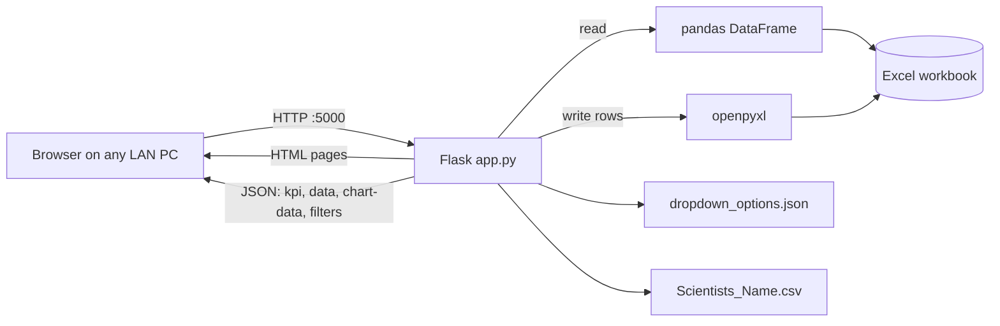

# Vishleshan: Offline Internship Management Dashboard


**Vishleshan** (Hindi for *analysis*) is a web dashboard that turns an Excel sheet of internship records into live KPIs, interactive charts and searchable tables, and lets HR staff add and edit records through validated forms. It runs **fully offline on a local network (LAN)** with no database, no CDN and no internet connection, and can be packaged as a single Windows executable.

It was built for the HR division of a defence research laboratory, where internship records were maintained in Excel and had to stay on an isolated network.

> **Note:** all data in this repository is synthetic. `sample_data.xlsx` contains made-up records for demonstration only.

<!-- Add screenshots here, for example:


-->

---

## Features

**Dashboard**
- 8 KPI cards: total students, female and male interns, branches, institutes, divisions, certificates issued, and average training weeks
- 6 charts with a selectable X axis, Y axis and chart type (bar, line, pie, doughnut), all drawn with a locally bundled Chart.js
- Filters on 13 columns (year, gender, affiliation, state, branch, division, scientist, mode of training and more); KPIs, charts and the table all respond to them
- Paginated data table (10 rows per page)
- Export the dashboard to PDF through the browser's print dialog

**Data entry and editing**
- Entry form with required-field validation, dropdowns and a scientist list loaded from a CSV
- Automatic `S.No.` assignment
- Duplicate detection: an entry matching an existing Name, Affiliation, Division and Period (compared after normalizing case and punctuation) is rejected with a clear message
- Edit form that finds a record by `S.No.` or by name, lists the matches when several students share a name, and shows a status banner (completed, in progress, or ended without certificate)
- Dropdown options (branch, division, designation, scientist and others) can be added or hidden from the UI and are saved in `dropdown_options.json`

**Data and deployment**
- Works directly on an `.xlsx` or `.xls` file; changes made in Excel appear on the next refresh
- Upload or switch the active Excel file from the dashboard
- If the workbook is open in Excel, saving retries and then returns a clear "close the file" message instead of failing silently
- Runs on a Windows LAN, so other PCs open it in a browser
- Packages into a standalone `.exe` with PyInstaller, and dependencies can be installed offline from a local `deps/` folder

---

## Tech stack

| Layer | Technology |
|---|---|
| Backend | Python, Flask, Flask-CORS |
| Data handling | pandas (read and aggregate), openpyxl (write to Excel), xlrd (legacy `.xls`) |
| Frontend | HTML, CSS, vanilla JavaScript, Chart.js (bundled locally) |
| Storage | Excel workbook (`.xlsx`), plus `dropdown_options.json` and a CSV for dropdown lists |
| Packaging | PyInstaller (`--onefile --noconsole`) |

---

## Architecture



1. The browser loads a page from Flask, and JavaScript then calls the JSON routes (`/kpi`, `/data`, `/chart-data`) to fill the KPIs, table and charts without reloading.
2. Every request re-reads the workbook with pandas, so the dashboard always shows the current contents of the file.
3. New and edited records are written by openpyxl, locating columns by **header name**, so column order does not matter.

---

## Project structure

```
vishleshan/
├── app.py                  # Flask app: routes, Excel I/O, validation, aggregation
├── templates/
│   ├── index.html          # Dashboard
│   ├── form.html           # New entry form
│   └── edit_form.html      # Edit form with status banner
├── static/
│   ├── script.js           # Dashboard logic (fetch, filters, charts, pagination)
│   ├── style.css
│   └── chart.umd.min.js    # Chart.js, served locally (no CDN)
├── sample_data.xlsx        # Synthetic demo data (19 columns)
├── Scientists_Name.csv     # Placeholder list for the scientist dropdown
├── dropdown_options.json   # User-added / hidden dropdown options
├── requirements.txt
├── build_exe.bat           # Build the standalone .exe
├── download_deps.bat       # Download wheels for offline installation
├── DRDO_Internship_Dashboard.spec   # PyInstaller spec
└── test_form.py            # Smoke tests for the submit endpoint
```

---

## Data model

The workbook needs a header row with these 19 columns (names must match):

`Year`, `S.No.`, `Name of Student`, `Gender`, `Affiliation`, `State`, `Branch`, `Branch Category`, `Field / Branch of Engg.`, `Division (DRDO)`, `Scientist Name`, `Designation`, `Period of Attachment`, `Time in Weeks`, `Mode of Training`, `Training Period`, `Topic Name`, `Certificate Issued`, `Certificate Issue Date`

Required in the entry form: every column above except `S.No.` (generated), `Topic Name`, `Certificate Issued` and `Certificate Issue Date`.

---

## Getting started

### Prerequisites
- Python 3.10 or newer
- Windows (the packaging scripts are Windows batch files; the app itself runs on any OS)

### Run from source

```powershell
git clone https://github.com/<your-username>/vishleshan.git
cd vishleshan

python -m venv venv
venv\Scripts\activate          # if blocked: Set-ExecutionPolicy -Scope Process Bypass
pip install -r requirements.txt

python app.py
```

Then open **http://127.0.0.1:5000**. The console prints the LAN address too.

### Use your own data
Place your workbook in the `uploads/` folder or use the **Upload** control on the dashboard. It must contain the 19 columns above.

### Access from other PCs on the LAN
1. Start the app on the server PC and find its IPv4 address with `ipconfig`.
2. Allow inbound TCP port 5000 through Windows Firewall (private network only):
   ```
   netsh advfirewall firewall add rule name="Vishleshan" dir=in action=allow protocol=TCP localport=5000
   ```
3. On any other PC in the same network, open `http://<server-ip>:5000`.

Give the server PC a fixed IP (or a DHCP reservation) so the address does not change after a restart.

### Build the standalone executable

On a PC with internet, download the dependencies once:

```powershell
download_deps.bat
```

Then, on the build PC (offline is fine):

```powershell
build_exe.bat
```

The executable is created at `dist\DRDO_Internship_Dashboard.exe`. Keep `dropdown_options.json`, the CSV and the `uploads/` folder next to it; templates, static files and the sample workbook are bundled inside the exe.

---

## API reference

| Method | Route | Purpose |
|---|---|---|
| GET | `/`, `/form`, `/edit-form` | HTML pages |
| GET | `/data` | Paginated, filtered rows (`page`, `per_page`, any column as a filter) |
| GET | `/kpi` | The 8 KPI values for the current filters |
| GET | `/columns` | Numeric and categorical column names |
| GET | `/filters` | Distinct values for the filter dropdowns |
| GET | `/chart-data` | Grouped labels and values (`x_axis`, `y_axis`, filters) |
| GET | `/meta`, `/reload` | Active file details; re-read and validate the file |
| POST | `/submit-form` | Add a record (201 created, 400 invalid, 409 duplicate, 423 file locked) |
| GET | `/get-entry` | Find a record by `sno` or `name` |
| POST | `/update-entry` | Update a record, identified by `original_sno` |
| GET / POST | `/dropdown-options`, `/dropdown-option` | Read and change dropdown lists |
| POST | `/upload`, `/set-active-file`, `/pick-file` | Choose the active Excel file |

---

## Design decisions

- **Excel as the data store.** The deployment environment allowed no database installation, and HR already works in Excel. The file stays the single source of truth and can still be edited by hand.
- **No CDN or external assets.** Chart.js and all styling are local, so the app works on an isolated network.
- **Always read fresh.** Reading the file on each request avoids a stale cache and keeps behaviour simple for a small dataset.
- **Header-based column mapping.** Reading and writing by column name keeps the app tolerant of reordered or extra columns.
- **Safe-ish writes.** Saving retries when Excel has the file locked, and the dropdown JSON is written atomically (temporary file, then replace).

---

## Known limitations and roadmap

This is an internal tool designed for a small, trusted team. Known gaps:

- [ ] **Concurrent writes:** the S.No. is `max + 1` and every save rewrites the whole workbook, so two simultaneous submissions can collide or one can overwrite the other. Planned: a write lock, then a move to SQLite.
- [ ] **No authentication or audit log.** Planned: login with roles and a record of who changed what.
- [ ] **Plain HTTP, open CORS.** Planned: HTTPS behind a reverse proxy, and removing CORS.
- [ ] **Output is not HTML-escaped** in some table cells, which is a stored-XSS risk. Planned: use `textContent` or escape values.
- [ ] **Edits skip the duplicate check.**
- [ ] **Development server.** It runs on Flask's built-in server; a production server such as Waitress is planned.
- [ ] **Active file is global**, so one user switching files switches it for everyone.
- [ ] **Performance:** the Excel file is re-read on each request. Planned: cache keyed on the file's modified time.
- [ ] The status banner parses dates only in `DD Mon YYYY to DD Mon YYYY` format.

---

## Security notes

- Do not expose this app to the internet. It has no login and uses plain HTTP.
- Do not commit real records. `.gitignore` excludes spreadsheets other than `sample_data.xlsx`, the `uploads/` folder and build output.
- When running from source, debug mode is on; turn it off (`debug=False`) before using it on a shared network.

---

## Testing

`test_form.py` posts sample entries to a running server. It writes to the **active** Excel file, so run it only against a copy of your data.

```powershell
python app.py        # terminal 1
python test_form.py  # terminal 2
```

---

## Team and credits

Built by a team of four during an internship. <!-- Edit: add names/roles. Example: "I was the main developer; a senior team member set up the LAN deployment." -->

AI coding assistants were used during development to speed up implementation. <!-- Keep or edit this line so it reflects how you actually worked. -->

## License

<!-- Choose a license, or leave this out if the project owner requires the code to remain unlicensed. -->
